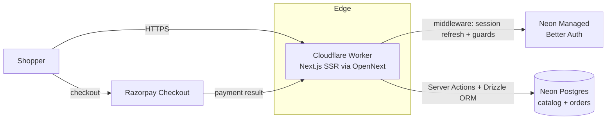

# janaushadhi-nextjs

> Jan Aushadhi generic-medicine e-commerce storefront — Next.js 15 on Cloudflare Workers via OpenNext.

[](./LICENSE)
[](https://github.com/chirag127/janaushadhi-ecommerce-nextjs/stargazers)
[](https://github.com/chirag127/janaushadhi-ecommerce-nextjs/commits/main)
[](https://github.com/chirag127/janaushadhi-ecommerce-nextjs/actions/workflows/test.yml)
[](https://nextjs.org)

## What it is / why it exists

A full storefront for selling generic medicines under the Pradhan Mantri Bhartiya Janaushadhi Pariyojana (PMBJP). Built on the Next.js App Router with Server Actions for every mutation, it deploys to Cloudflare Workers through OpenNext and reads its catalog and commerce data from a serverless Neon Postgres via Drizzle ORM. Checkout runs through Razorpay (test mode) with a Cash-on-Delivery fallback. This is one of four framework variants (astro / nextjs / laravel / wordpress) sharing the same Neon Postgres project, so the same shop can be compared across stacks.

**Live:** https://janaushadhi-nextjs.oriz.in · **Repo:** https://github.com/chirag127/janaushadhi-ecommerce-nextjs

⭐ If this is useful, please star the repo — it helps others find it.

## Architecture



## Features

- **Storefront:** landing page, product catalog (search, category filter, price range, sort, pagination), product detail (reviews, related products, JSON-LD), cart with free-shipping progress, checkout (saved addresses + coupon codes + Razorpay / COD), order confirmation, order history, wishlist, dark/light/system theme.
- **Account:** dashboard (order/address/wishlist counts), orders, address book (CRUD), wishlist, profile.
- **Admin (`role = admin`):** dashboard (revenue, orders, products, customers, low-stock), products CRUD, categories, coupons (percent/fixed, min order, usage limit, expiry), orders + status management, inventory.
- **Platform:** SSR auth (email/password + OAuth), middleware session refresh + route guards (`/account`, `/checkout`, `/admin`), Server Actions for all mutations, `sitemap.xml`, `robots.txt`.

## Tech stack

| Layer | Technology |
|---|---|
| Framework | Next.js 15 (App Router, SSR, Server Actions) |
| Deployment | OpenNext (`@opennextjs/cloudflare`) → Cloudflare Workers |
| Database | Neon Postgres (`@neondatabase/serverless`) + Drizzle ORM |
| Auth | Neon Managed Better Auth (`@neondatabase/auth`) |
| Payments | Razorpay (test mode) + COD |
| Styling | Tailwind CSS v3, `next-themes`, Lucide icons, CVA |
| Validation | Zod |
| Language | TypeScript 5 |

## Repository structure

```
janaushadhi-nextjs/
├── next.config.ts          # Next.js config
├── open-next.config.ts     # OpenNext → Cloudflare adapter
├── wrangler.jsonc          # Cloudflare Worker config
├── vercel.json             # optional Vercel deploy config
├── src/
│   ├── app/                # App Router routes (storefront, account, admin, api)
│   ├── components/         # UI components
│   ├── lib/                # db (Drizzle), auth, server actions, helpers
│   └── middleware.ts       # session refresh + route guards
├── neon-migration/ · meds.csv · scripts/   # schema + catalog seed
└── .github/workflows/      # test.yml, deploy.yml, megalinter.yml
```

## Quick start

```bash
pnpm install
cp .env.example .env.local   # fill in values — see Configuration below
pnpm dev                     # http://localhost:3000
pnpm build                   # production build via OpenNext
pnpm lint                    # ESLint
pnpm type-check              # tsc --noEmit
pnpm test                    # Vitest
```

## Deployment

Deploys automatically on push to `main` (`.github/workflows/deploy.yml`): build with `opennextjs-cloudflare build` → deploy with `wrangler deploy` → push runtime secrets to the Worker via `wrangler secret put`. Required GitHub secrets include `CLOUDFLARE_API_TOKEN`, `CLOUDFLARE_ACCOUNT_ID`, and the env vars below. A `vercel.json` is present for optional Vercel deploys.

## Configuration

Copy `.env.example` to `.env.local`. Names and purpose only — never commit real values.

| Variable | Purpose |
|---|---|
| `DATABASE_URL` | Neon pooled connection string |
| `DATABASE_URL_UNPOOLED` | Neon direct connection string (migrations) |
| `NEON_AUTH_BASE_URL` | Base URL of the Neon Managed Better Auth endpoint |
| `NEON_AUTH_COOKIE_SECRET` | Cookie signing secret, min 32 chars |
| `NEON_AUTH_COOKIE_DOMAIN` | Optional — share auth cookies across subdomains for SSO |
| `NEXT_PUBLIC_SITE_URL` | Public site origin (SEO metadata, sitemap, OAuth redirects) |
| `NEXT_PUBLIC_APP_URL` | Same as `NEXT_PUBLIC_SITE_URL` |
| `NEXT_PUBLIC_RAZORPAY_TEST_MODE` | `"true"` keeps Razorpay in test mode; `"false"` for live |
| `RAZORPAY_KEY_ID` | Razorpay API key ID (Worker secret in production) |
| `RAZORPAY_KEY_SECRET` | Razorpay API key secret (Worker secret in production) |

## Part of the oriz family

This is one of ~80 sites in the **oriz** family. More at [blog.oriz.in](https://blog.oriz.in).

**Cost:** runs at ~$0 on the Cloudflare free tier (Workers via OpenNext) with a Neon free-tier Postgres.

## Contributing

Issues and PRs welcome. Keep changes focused; run `pnpm lint`, `pnpm type-check`, and `pnpm test` before opening a PR.

## Security

No secrets in the repo — `.env*` is gitignored, a sops+age vault holds real values, and only `NEXT_PUBLIC_*` vars reach the browser.

## License

MIT © 2026 Chirag Singhal — see [LICENSE](./LICENSE).

## Author

Chirag Singhal · chirag@oriz.in

## Status

Stable / actively maintained. Conventional commits are the changelog.
